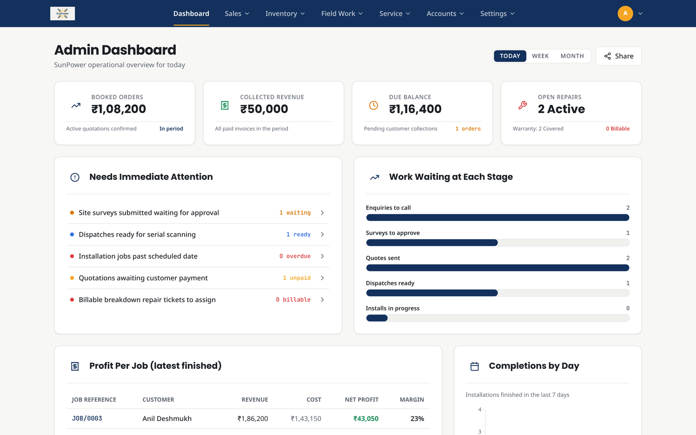
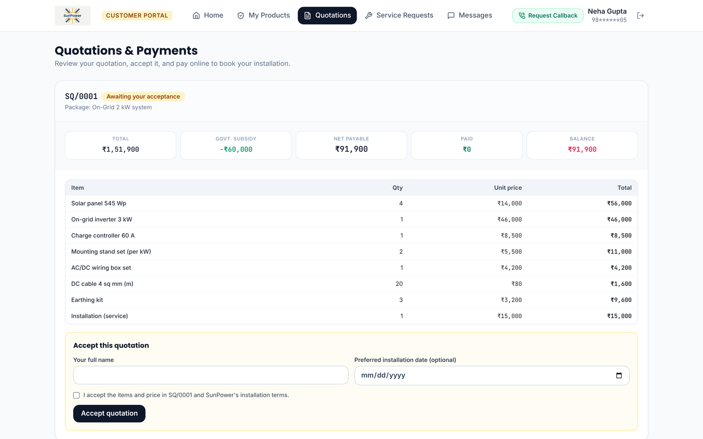
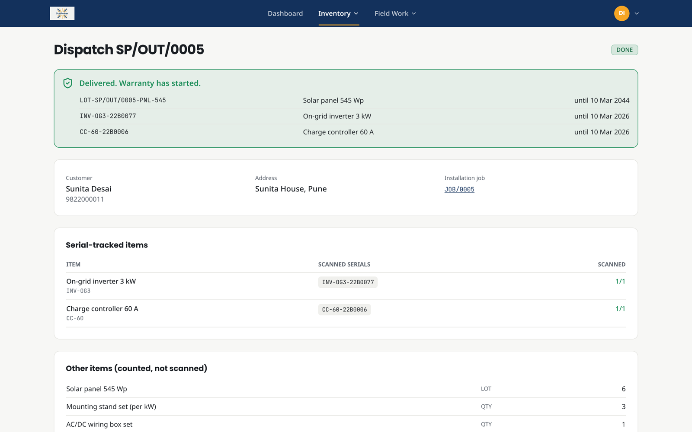
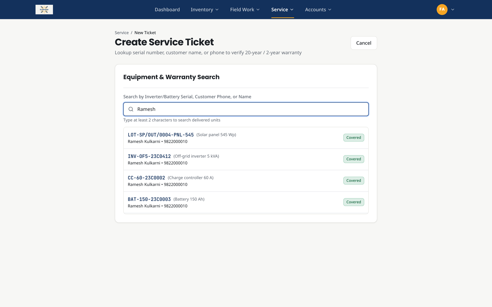
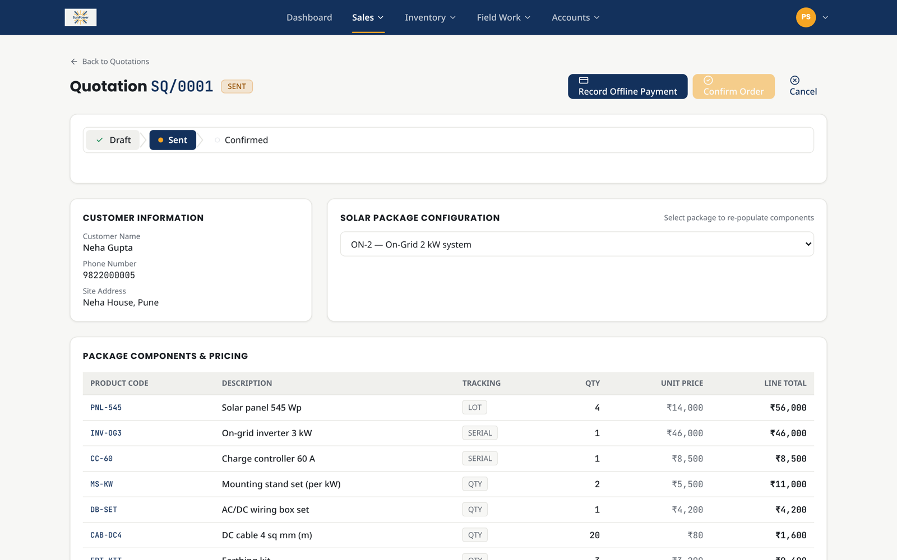
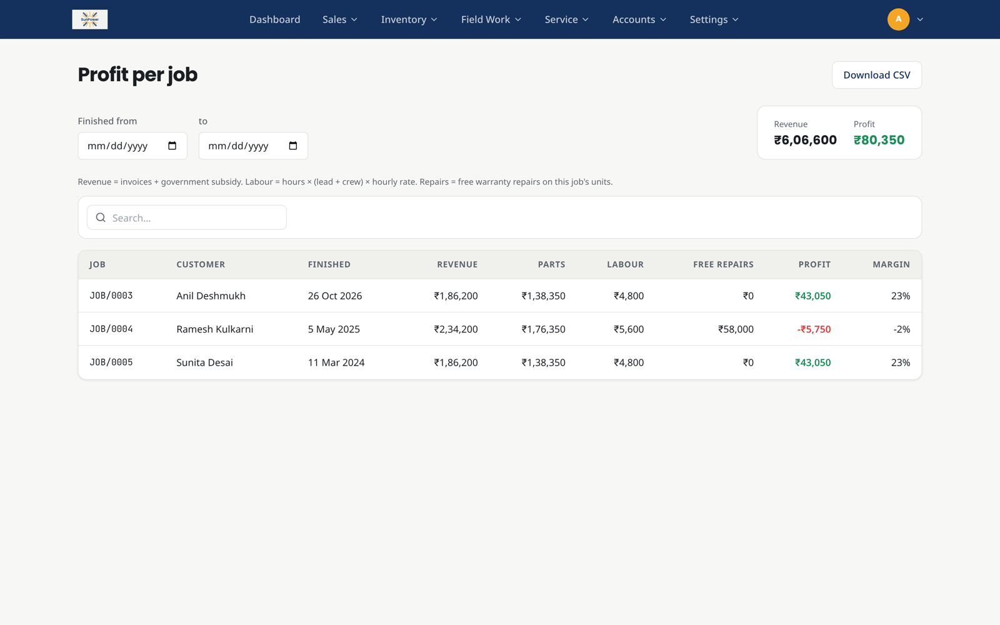
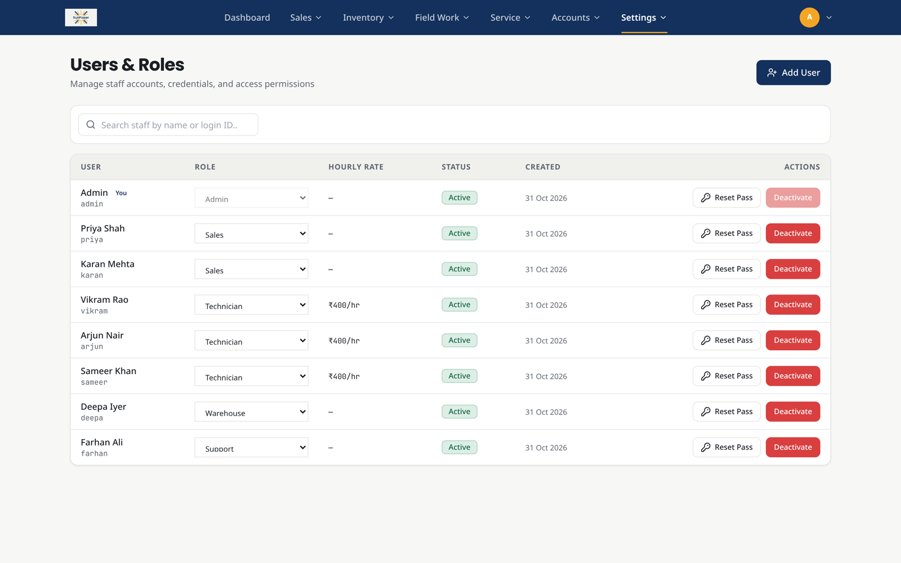
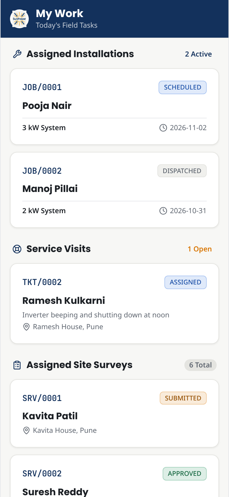
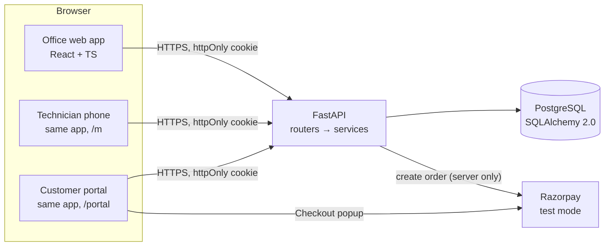

<div align="center">


# SunPower — Solar Installation Management System

**One ERP for a rooftop-solar company, from the first enquiry to the twenty-year warranty.**

Replaces WhatsApp quotes and paper site registers with a single web app for the office, a phone app for field technicians, and a self-service portal for customers.


-0C2451)


</div>

---

## Contents

- [The problem](#the-problem)
- [What it does](#what-it-does)
- [Screenshots](#screenshots)
- [How a job flows through the system](#how-a-job-flows-through-the-system)
- [Roles and access](#roles-and-access)
- [Architecture](#architecture)
- [Business rules enforced on the server](#business-rules-enforced-on-the-server)
- [Security](#security)
- [Getting started](#getting-started)
- [Demo accounts](#demo-accounts)
- [Running the tests](#running-the-tests)
- [Project structure](#project-structure)
- [API overview](#api-overview)

---

## The problem

SunPower Solutions installs about 40 rooftop systems a month with 15 technicians. Quotes travel over WhatsApp, site measurements live in paper registers, warehouse serial numbers are written by hand, and nobody can say quickly whether a broken inverter is still under warranty or which jobs actually made money.

SunPower (the app) covers the six scenes of the brief end to end:

| # | Scene | What the system guarantees |
|---|---|---|
| 1 | **Rooftop enquiry** | Enquiries from the web, phone and WhatsApp in one list; a qualifying call; a technician's site survey. **No quotation until the survey is approved.** |
| 2 | **Getting the kit right** | Quotation built from a package template; parts list and subsidy fill in automatically; advance or full payment. **No booking without a payment.** Confirming creates the job and the warehouse dispatch together. |
| 3 | **Dispatch day** | Every inverter, battery and controller is **scanned by serial**. Validate stays locked until all are scanned. **Warranty starts automatically** (2 years electronics, 20 years panels). |
| 4 | **On the roof** | Technician's phone: start/finish time, confirmed system size, photos and the **customer's signature**. |
| 5 | **Breakdown** | Find the customer and serial in seconds. Under warranty → ₹0; expired → parts + labour billed automatically. **Ticket stays open until the customer confirms.** |
| 6 | **Owner's month-end** | Today / week / month dashboard, money booked / collected / due, open repairs, and **profit per job** including free warranty repairs. |

## What it does

**Office (web app)**
- **Sales:** enquiry list with stage filter, qualifying call, survey scheduling and approval, quotations from package templates, offline payment recording, booking confirmation.
- **Warehouse:** stock (on hand / reserved / free), goods receipts, dispatch with serial scanning (USB scanner or keyboard), serial lookup with warranty status.
- **Support:** live lookup by serial, phone or name with a Covered / Expired badge, ticket workflow, automatic repair invoices, customer messages.
- **Admin:** live dashboard, profit-per-job report (with CSV export), invoices, and **Users & Roles** to add staff, change roles and deactivate accounts.

**Technician (phone app)**
- Today's installations, site surveys and **service visits**, in large touch-friendly cards.
- Survey form with roof photos; installation worksheet with size, photos and an on-screen **signature pad**; repair form with parts and labour.

**Customer (self-service portal)**
- Sign up with phone + password, verified by a **one-time code**; sign in; forgot password.
- Progress tracker and notifications, quotation review and **acceptance**, online payment through **Razorpay** (25 % advance, full amount or a custom amount; the remaining balance after installation).
- Delivered products with warranty status, service requests, and messages to the company.

Every screen refreshes on its own every few seconds, and each action instantly refreshes the pages it affects, so several people can work at once and see each other's changes.

## Screenshots

| Admin dashboard (live data) | Customer portal: accept & pay |
|---|---|
|  |  |

| Warehouse: serials scanned, warranty started | Support: find a unit in seconds |
|---|---|
|  |  |

| Sales: quotation with payments | Profit per job |
|---|---|
|  |  |

| Users & Roles | Technician's phone |
|---|---|
|  |  |

## How a job flows through the system

```mermaid
flowchart LR
    A[Enquiry<br/>portal / call / web] --> B[Qualifying call<br/>Sales]
    B --> C[Site survey<br/>Technician phone]
    C --> D{Survey<br/>approved?}
    D -- no --> B
    D -- yes --> E[Quotation<br/>from package]
    E --> F[Customer accepts<br/>+ pays advance]
    F --> G[Booking confirmed<br/>job + dispatch created]
    G --> H[Serial scan + validate<br/>warranty starts]
    H --> I[Installation<br/>photos + signature]
    I --> J[Balance paid]
    J --> K[Service request]
    K --> L[Technician repair<br/>₹0 if covered]
    L --> M[Customer confirms<br/>ticket closed]
```



## Roles and access

| Role | Lands on | Can do |
|---|---|---|
| **Admin** | Dashboard | Everything, plus users & roles and the profit report |
| **Sales** | Enquiries | Enquiries, surveys (approve), quotations, payments, invoices |
| **Technician** | Phone home | Own surveys, own installations, own service visits — nothing else |
| **Warehouse** | Dispatches | Stock, receipts, dispatch scanning and validation, serials |
| **Support** | Tickets | Tickets, serial lookup, invoices, customer messages |
| **Customer** | Portal | Only their own enquiries, quotations, payments, products and requests |

Staff permissions live in one file, [`shared/access.json`](shared/access.json), read by both the API (`require_perm`) and the web app (menu and route guards). Customers are not a staff role: they use a separate login, cookie and API.

## Architecture



| Layer | Choice | Why |
|---|---|---|
| API | **FastAPI** (sync endpoints) + **Pydantic v2** | Dependency injection for auth/permissions, request validation with clear errors, automatic `/docs` |
| Data | **PostgreSQL** + **SQLAlchemy 2.0** | Transactions and row locks for money, stock and status changes |
| Auth | **JWT in an httpOnly, SameSite=Lax cookie**, bcrypt passwords | The token is never readable by JavaScript |
| Web | **React 18 + TypeScript + Vite + Tailwind** | One app with three surfaces: office, phone (`/m`) and customer portal (`/portal`) |
| Server state | **TanStack Query** | Caching, 5-second background refresh and instant invalidation after each action |
| Payments | **Razorpay** (test mode) | Order created on the server; payment confirmed only by Razorpay's signature |
| Images | Stored in PostgreSQL (`images` table) | One backup, saved in the same transaction as the record, verified with Pillow |
| Tooling | **uv** (Python), npm | Reproducible installs (`uv.lock`, `package-lock.json`) |

The API uses one error shape everywhere — `{"error": "message", "field": "name" | null}` — and consistent status codes: 400 invalid input, 401 not logged in, 403 not allowed, 404 not found, **409 a business rule blocks this step**.

## Business rules enforced on the server

The buttons in the UI are disabled with a reason, but every rule below is checked again by the API, so it cannot be skipped with Postman or the browser console.

| Rule | Where |
|---|---|
| No quotation until the site survey is approved | `routers/quotations.py` |
| No booking confirmation without a payment | `routers/quotations.py` |
| A customer must accept a quotation before paying online; the **amount is computed on the server** | `routers/portal.py` |
| Dispatch validates only when every serial is scanned; the row is locked so two people can't ship the last unit | `services/stock.py` |
| Warranty dates are set at validation (24 / 240 months) | `services/stock.py` |
| A job can't start before its dispatch is done, or finish without a signature and a photo | `routers/jobs.py` |
| Warranty is decided when the ticket is opened; out-of-warranty repairs create an invoice | `routers/tickets.py` |
| A ticket closes only after the customer confirms | `routers/tickets.py`, `routers/portal.py` |
| Every status change goes through one state machine | `app/transitions.py` |
| A payment never appears twice: paying the balance settles the existing balance invoice | `services/payments.py` |
| At least one active admin must always remain; an admin can't demote or deactivate themself | `routers/users.py` |

## Security

- **Permissions on every endpoint** via `require_perm(...)`; technicians are filtered to their own surveys, jobs and tickets on the server.
- **Passwords** hashed with bcrypt; the hash is never returned. Login failures for unknown and wrong passwords return the same message.
- **Customer accounts:** a one-time code proves the customer owns the phone number before an account is linked to their quotations. Codes are stored hashed, expire in 5 minutes, work once, allow 5 attempts, and are rate-limited (1 per 30 s, 3 per 10 min). Five wrong passwords lock the account for 15 minutes. "Forgot password" gives the same reply whether or not the number is registered.
- **Separate customer session:** its own cookie, its own signing key and a `kind: "customer"` claim — a customer token is rejected by every staff endpoint and vice versa. Another customer's record returns **404**, never 403, so ids can't be probed.
- **Payments:** the Razorpay key secret stays on the server; each payment is accepted only if Razorpay's HMAC-SHA256 signature matches, and verification is idempotent.
- **Uploads:** login required, 5 MB limit, image bytes verified with Pillow, random names, `X-Content-Type-Options: nosniff`, no SVG.
- **Inputs:** every request body is a Pydantic model with limits; all queries are parameterised through SQLAlchemy.

## Getting started

### Prerequisites

- Python **3.12** and [**uv**](https://docs.astral.sh/uv/) (`pip install uv`)
- Node.js **18+** and npm
- PostgreSQL **14+**

### 1. Install

```bash
git clone https://github.com/Shoaibahmed-2005/sunpower-odoo.git
cd sunpower-odoo
npm install                          # root: runs API + web together
cd client && npm install && cd ..
cd server && uv sync && cd ..
```

### 2. Configure

```bash
createdb sunpower                    # or create it in pgAdmin
cp server/.env.example server/.env   # then edit DATABASE_URL and JWT_SECRET
```

Optional: add Razorpay **test** keys (`RAZORPAY_KEY_ID`, `RAZORPAY_KEY_SECRET`) to enable online payment. Without them the portal shows "Online payment isn't available" and staff record payments offline.

### 3. Seed demo data and run

```bash
npm run reset    # creates all tables and loads demo data (wipes the database!)
npm run dev      # API on http://localhost:8000, web on http://localhost:5173
```

- Office app: <http://localhost:5173>
- Customer portal: <http://localhost:5173/portal>
- Public enquiry form: <http://localhost:5173/enquire>
- API docs (Swagger): <http://localhost:8000/docs>

To use the technician screens on a real phone, connect it to the same Wi-Fi and open `http://<your-laptop-ip>:5173`.

**Razorpay test payment:** in the checkout choose *Netbanking* → any bank → *Success*.

## Demo accounts

All staff passwords are `sun123`. The login page also has one-click demo buttons.

| Login | Role |
|---|---|
| `admin` | Admin |
| `priya`, `karan` | Sales |
| `vikram`, `arjun`, `sameer` | Technician |
| `deepa` | Warehouse |
| `farhan` | Support |

**Customer portal** (password `sun123`): `9822000005` (Neha Gupta — quotation waiting for acceptance) and `9822000010` (Ramesh Kulkarni — installed system under warranty). Any other demo customer can sign up with their phone number; in demo mode the one-time code is shown on screen.

The seed contains a customer in every stage of the flow, an expired-warranty inverter (`INV-OG3-22B0077`) and a covered one (`INV-OF5-23C0412`), and one job whose free warranty repairs make its profit negative.

## Running the tests

```bash
cd server
uv run pytest -q
```

62 tests cover every gate above, permissions per role, the customer portal (accounts, codes, lockout, data scoping), Razorpay order and signature handling (the gateway is mocked), and serial scanning. Tests **never touch your real database** — `tests/conftest.py` points them at a throwaway SQLite file. Set `TEST_DATABASE_URL` to a separate PostgreSQL database to also run the row-lock concurrency test.

Frontend type check:

```bash
cd client
npx tsc --noEmit
```

## Project structure

```
sunpower-odoo/
├── client/                      React + TypeScript (Vite)
│   ├── public/brand/            logo files
│   └── src/
│       ├── api/                 axios client (cookie auth, error toasts)
│       ├── auth/                AuthContext, can(permission)
│       ├── components/          Layout, DataTable, Badge, SignaturePad, PhoneLayout, …
│       ├── lib/                 query client, query keys, formatting, Razorpay loader
│       ├── pages/
│       │   ├── sales/           enquiries, surveys
│       │   ├── quotes/          quotations
│       │   ├── inventory/       stock, receipts, dispatches, serials
│       │   ├── field/           installation jobs
│       │   ├── service/         tickets, customer messages
│       │   ├── accounts/        invoices
│       │   ├── dashboard/       dashboard, profit report
│       │   ├── admin/           users & roles
│       │   ├── mobile/          technician phone screens
│       │   └── portal/          customer portal
│       ├── portal/              portal API client, layout, guard
│       └── routes/              route tables per area
├── server/                      FastAPI + SQLAlchemy
│   ├── app/
│   │   ├── main.py              app, routers, error handlers
│   │   ├── models.py            all tables and enums
│   │   ├── auth.py              staff auth, require_perm
│   │   ├── customer_auth.py     customer sessions and data scoping
│   │   ├── transitions.py       status state machine
│   │   ├── routers/             one file per area
│   │   ├── services/            stock, payments, Razorpay, OTP
│   │   └── seed.py              demo data (npm run reset)
│   ├── tests/                   pytest suite
│   └── .env.example
├── shared/access.json           role → permissions (API and web)
├── docs/screenshots/
└── package.json                 npm run dev / reset
```

## API overview

All endpoints are under `/api`; the full interactive reference is at `/docs` when the server is running.

| Area | Endpoints |
|---|---|
| Staff auth & users | `POST /auth/login`, `POST /auth/logout`, `GET /auth/me`, `GET/POST/PATCH /users`, `POST /users/{id}/reset-password` |
| Enquiries & surveys | `GET/POST /leads`, `POST /leads/{id}/log-call`, `/schedule-survey`, `/lost`, `POST /public/enquiries`, `GET /surveys`, `PATCH /surveys/{id}/submit`, `POST /surveys/{id}/approve`, `/reject` |
| Quotations & invoices | `POST /leads/{id}/quotation`, `GET/PATCH /quotations/{id}`, `/send`, `/cancel`, `/payments`, `/confirm`, `GET /invoices`, `POST /invoices/{id}/mark-paid` |
| Inventory | `GET /products`, `/packages`, `/stock`, `/serials`, `GET /dispatches/{id}`, `POST /dispatches/{id}/scan`, `/unscan`, `/validate`, receipts |
| Field & service | `GET /jobs`, `/jobs/mine`, `POST /jobs/{id}/start`, `/finish`, `GET /tickets/lookup`, `GET /tickets/mine`, `POST /tickets`, `POST /tickets/{id}/transition` |
| Dashboard | `GET /dashboard?period=today\|week\|month`, `GET /reports/profit`, `GET /reports/profit.csv` |
| Uploads | `POST /uploads`, `GET /images/{id}` |
| Customer portal | `POST /portal/auth/signup/start`, `/signup/verify`, `/login`, `/password/forgot`, `/password/reset`; `GET /portal/overview`, `/notifications`, `/products`, `/quotations`; `POST /portal/quotations/{id}/accept`, `/order`; `POST /portal/payments/verify`; tickets, messages, enquiry |

---

<div align="center">
Built for the Odoo hiring hackathon.
</div>
